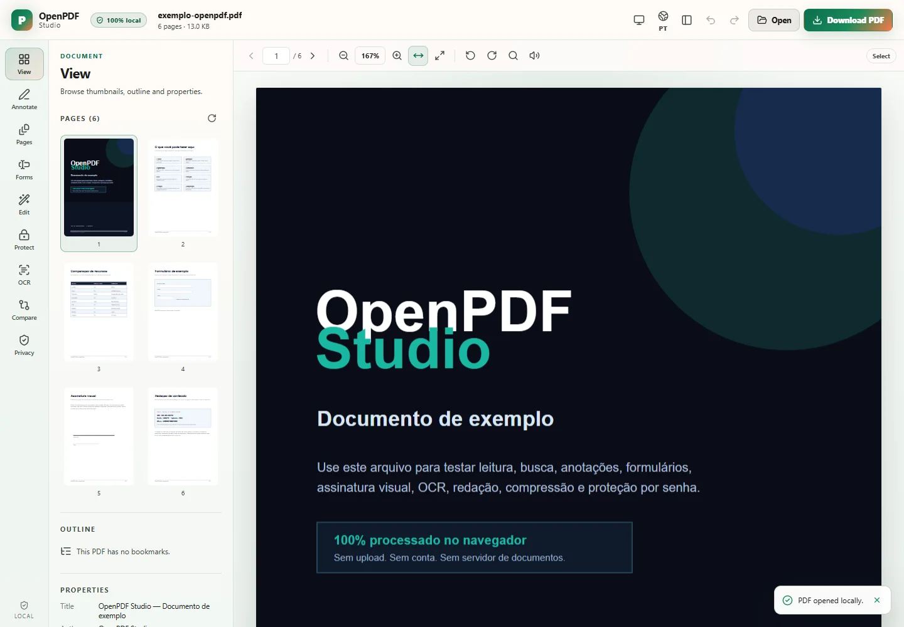

# OpenPDF Studio

[](https://claudiobzrr.github.io/open-pdf-studio/app/)
[](https://claudiobzrr.github.io/open-pdf-studio/)
[](https://github.com/ClaudioBzrr/open-pdf-studio/releases)
[](LICENSE)
[](https://claudiobzrr.github.io/open-pdf-studio/app/)

**Private, local-first PDF workspace in your browser.** Read, annotate, edit, sign, OCR, redact, compress and protect PDFs without uploading them. Open source, MIT licensed, installable PWA.

- **Live app:** https://claudiobzrr.github.io/open-pdf-studio/app/
- **Landing:** https://claudiobzrr.github.io/open-pdf-studio/ · [Português](https://claudiobzrr.github.io/open-pdf-studio/pt/)
- **Source:** https://github.com/ClaudioBzrr/open-pdf-studio
- **Releases:** https://github.com/ClaudioBzrr/open-pdf-studio/releases



> **Not affiliated with Adobe.** This is an independent implementation built with open-source libraries. It does not copy proprietary Acrobat code, bypass DRM or unlock paid Adobe features.

---

## Why it exists

Adobe Acrobat is a native, closed product with paid features tied to licensing and services. OpenPDF Studio delivers **open functional equivalents** for everyday PDF work with one important difference: the document never leaves the browser.

| Principle | Implementation |
|---|---|
| No upload | The PDF is read via `File`/`ArrayBuffer` and processed in memory. |
| No backend | Static build; deploy on any static host. |
| No telemetry | No analytics, tracking cookies or document-related network calls. |
| Offline | PWA shell cached by a service worker; OCR models cached after first use. |
| Auditable | Open TypeScript source and open-source dependencies. |

---

## Features

### Read and navigate
- PDF.js rendering, text layer, selection/copy.
- Zoom, fit width/page, per-page rotation.
- Thumbnails with lazy loading, outline and metadata.
- Full-text search with page results and highlights.
- Read current page aloud via Web Speech API.
- Keyboard shortcuts (`←/→`, `Ctrl+O`, `Ctrl+S`, `Ctrl+Z`, `Ctrl+F`, `Delete`).

### Annotate and edit
- Highlight, underline, strikeout, comments, pen, rectangle, arrow and text.
- Move selected annotations, delete, undo/redo.
- Images, whiteout and visual signatures (draw or type).
- Export a flattened PDF or annotations as JSON.
- Overlay editing — no original text reflow.

### Organize pages
- Drag-and-drop reorder.
- Delete, duplicate, extract, split, merge and rotate.
- Metadata preserved in page operations.

### Forms
- Read and fill AcroForm fields: text, checkbox, radio, dropdown and list.
- Update appearances, flatten and download.

### OCR
- Tesseract.js with local Portuguese and English models.
- Current page or all pages.
- Export text or generate a **searchable PDF** with an invisible text layer.
- No page image is uploaded.

### Security
- **AES-256** encryption with `@cantoo/pdf-lib`.
- Open and owner passwords.
- Print, copy, modify, annotate, form-fill, accessibility and assembly permissions.
- Password removal with the current password.
- Warning when exporting removes an existing password.

### Redaction, compression and comparison
- Irreversible rasterized redaction with optional metadata removal.
- Compression with configurable DPI and JPEG quality.
- Visual per-page comparison with red/green similarity indicators.

### PWA and bilingual UI
- Installable PWA with offline app shell.
- English and Brazilian Portuguese, switchable in the app.
- Light and dark themes using the **Open Run** palette (green `#0B6E4F`, coral `#FF7A45`, warm surfaces).

### Native desktop app
- Separate Rust app built with `egui`/`eframe` and PDFium — no webview, no Tauri.
- Native tabs, thumbnails, search, zoom, view rotation, page extraction, rectangle annotations and sticky notes.
- Windows x64 build 0.2.0 with per-user installer and PDF file association script.
- Honest scope: OCR, AES-256, redaction, compression, comparison, certified signatures, forms and full page organization remain on the desktop roadmap.

---

## Privacy model

- Documents stay in tab memory. Reloading or closing the tab discards them.
- Only UI preferences (theme, language) are stored in `localStorage`.
- The service worker caches the app shell and sample PDF; **it never caches user PDFs**.
- OCR assets are cached after first use; run OCR once online before going fully offline.
- The app is a static build. There is no document backend to breach.

Honest limit: browser security is not an OS sandbox. Keep the browser and dependencies updated.

---

## Quick start

Requirements: Node.js 22+ and npm.

```bash
npm install
npm run dev
```

Open `http://127.0.0.1:5173/app/`.

Production build:

```bash
npm run build
npm run preview
```

`dist/` is a static site with three entries:

- `/` — English landing
- `/pt/` — Portuguese landing
- `/app/` — PDF workspace

---

## GitHub Pages

The project is deployed to **GitHub Pages** by `.github/workflows/pages.yml`:

1. `npm ci`
2. `npm test`
3. `npm run build` with `VITE_BASE=/open-pdf-studio/`
4. Upload `dist/` and deploy with `actions/deploy-pages`.

Live URLs:

- https://claudiobzrr.github.io/open-pdf-studio/
- https://claudiobzrr.github.io/open-pdf-studio/pt/
- https://claudiobzrr.github.io/open-pdf-studio/app/

For local subpath testing:

```powershell
$env:VITE_BASE='/open-pdf-studio/'
npm run build
npm run preview
```

---

## Tests

```bash
npm test          # Vitest unit tests
npm run sample    # regenerate public/sample.pdf
```

Real-browser tests with Chrome (requires `playwright-core` and `npm run dev`):

```bash
node scripts/test-ui.mjs
node scripts/test-tools.mjs
node scripts/test-final.mjs
node scripts/test-extra.mjs
node scripts/test-textlayer.mjs
node scripts/test-pages.mjs
node scripts/test-offline-sample.mjs
```

The suite covers loading, rendering, text selection, search, annotations, forms, AES-256, OCR, redaction, compression, comparison, signature, page deletion and offline PWA reload.

---

## Architecture

```text
src/
  App.tsx                    document/folder orchestration and tool state
  i18n.tsx                   English/Portuguese dictionary and provider
  theme.ts                   system/light/dark theme persistence
  components/
    PageCanvas.tsx           canvas + text layer + annotation SVG overlay
    Viewer.tsx               toolbar, zoom, search, read-aloud
    Sidebar.tsx              tool navigation
    panels/                  View, Annotate, Pages, Forms, Edit, Protect, OCR, Compare, Privacy
  lib/
    pdf.ts                   PDF.js load/render/text/outline/search
    annotations.ts           annotation drawing/flattening
    pages.ts                 reorder, delete, duplicate, extract, split, merge
    forms.ts                 AcroForm
    protect.ts               AES-256
    redact.ts                irreversible raster redaction
    compress.ts              raster compression
    ocr.ts                   Tesseract + searchable PDF
    compare.ts               visual diff
  landing.css                static landing design system
  landing.ts                 landing theme/menu/install/PWA registration
app/index.html               app shell
index.html                   English landing
pt/index.html                Portuguese landing
public/
  sample.pdf                 6-page demo document
  screenshots/               landing screenshots (webp)
  icons/                     PWA icons
  tessdata/                  local OCR models
  vendor/tesseract/          worker + core WASM
  robots.txt, sitemap.xml
  llms.txt, llms-full.txt    LLM/GEO context
  _headers, 404.html
desktop/
  src/main.rs                CLI and eframe startup
  src/app.rs                 native UI: tabs, viewer, search, annotations
  src/pdf.rs                 PDFium engine, rendering, save/extract
  src/theme.rs               Open Run palette + IBM Plex fonts
  src/i18n.rs                English/Portuguese strings
  scripts/                   PDFium fetch, packaging, Windows install/uninstall
  assets/                    IBM Plex fonts, app icon
docs/
  adobe-acrobat-analysis.md
  adobe-acrobat-analysis.pt-BR.md
  desktop-rust.md
  desktop-rust.pt-BR.md
  release-v0.2.0.md
```

### Theme

The palette follows the **Open Run** design system:

| Token | Light | Dark |
|---|---|---|
| Primary | `#0B6E4F` | `#7DDBAF` |
| Primary dark | `#064732` | `#003824` |
| Accent | `#FF7A45` | `#FFB59A` |
| Surface | `#FFFBF8` | `#101412` |
| Surface variant | `#DDE5DF` | `#414944` |

---

## Documentation

- [Adobe Acrobat analysis (EN)](docs/adobe-acrobat-analysis.md)
- [Análise do Adobe Acrobat (PT)](docs/adobe-acrobat-analysis.pt-BR.md)
- [Desktop Rust architecture (EN)](docs/desktop-rust.md)
- [Arquitetura desktop Rust (PT)](docs/desktop-rust.pt-BR.md)
- [Release notes v0.2.0 (EN/PT)](docs/release-v0.2.0.md)
- [Português README](README.pt-BR.md)

---

## Desktop app in Rust

`v0.2.0` ships the first native desktop build: **OpenPDF Studio Desktop**, written from scratch in Rust with `egui`/`eframe` and PDFium. It is **not** a Tauri port of the web UI and does not reuse the React frontend.

- Download: [openpdf-desktop-windows-x64.zip](https://github.com/ClaudioBzrr/open-pdf-studio/releases/latest/download/openpdf-desktop-windows-x64.zip)
- Source and build instructions: [`desktop/README.md`](desktop/README.md)
- Architecture notes: [docs/desktop-rust.md](docs/desktop-rust.md)

Current desktop scope: native viewer, tabs, thumbnails, search, zoom, view rotation, page extraction, rectangle annotations, sticky notes, Save/Save As, and English/Portuguese UI. OCR, AES-256, redaction, compression, comparison, certified signatures, forms and full page organization remain on the desktop roadmap. The web app remains the reference for those workflows.

---

## REA analysis

The installed Adobe application was **Adobe Acrobat 26.2.21931.0**:

- `C:\Program Files\Adobe\Acrobat DC\Acrobat\Acrobat.exe`
- PE32+ x64, SHA-256 `b4b6e679c69679091ca70fdfe847850943b729c1a5b21e179bc080a538454621`
- 49 PE resources, 63 data directories
- Plug-ins: `AcroForm`, `Annots`, `DigSig`, `PPKLite`, `EScript`, `Search`, `Accessibility`, `ReadOutLoud`, `reflow`, `TouchUp`, `Checkers`, `Multimedia`, `StorageConnectors`, `MSRMS`, `Updater`, among others.

REA had no Ghidra/IDA configured, so the analysis stayed at **identity, resource and component/plug-in surface** level. No proprietary algorithms were decompiled and no license/DRM bypass was attempted.

---

## Known limitations

- No full text **reflow** editing; text/images are overlays.
- No **certified digital signature** (PAdES/ICP-Brasil); visual signature only.
- No **PDF/A, Preflight, color management** or print production.
- No **XFA, 3D, advanced multimedia or document JavaScript**.
- No **DRM/RMS, Document Cloud, Adobe Fonts or cloud storage**.
- OCR accuracy depends on scan quality; handwriting and complex layouts may fail.
- Page operations may not preserve complex form/XFA structures.
- Redaction rasterizes marked pages; compression may increase vector PDFs.

---

## Releases

`v0.2.0` adds the first native Windows desktop build. Each release attaches:

- `open-pdf-studio-web.zip` — static web/PWA build.
- `openpdf-desktop-windows-x64.zip` — native Rust desktop app with `pdfium.dll`, licenses and installer scripts.

The release workflow builds both assets on tags matching `v*`.

```bash
git tag v0.2.0
git push origin v0.2.0
```

---

## License

MIT. See [LICENSE](LICENSE). Third-party libraries retain their original licenses (PDF.js Apache-2.0; pdf-lib/@cantoo MIT; Tesseract.js Apache-2.0; React/Vite MIT; JSZip MIT; idb ISC).
